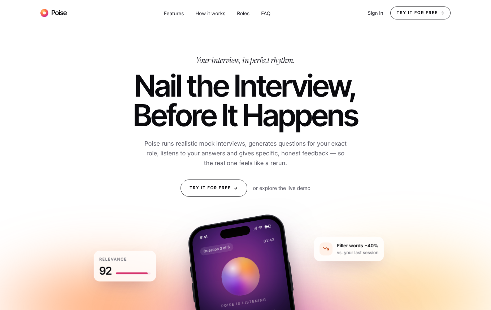
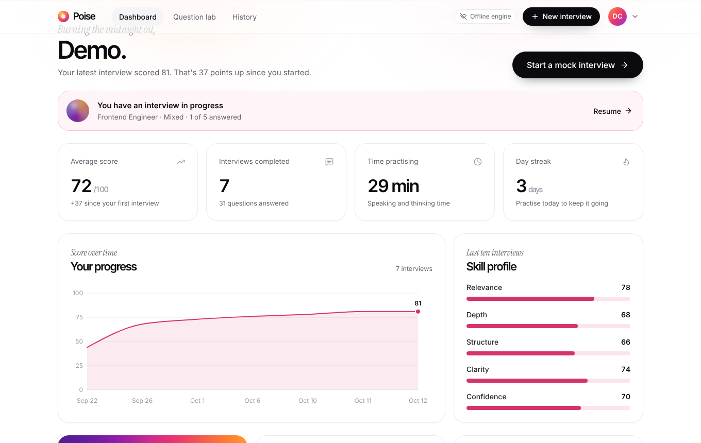
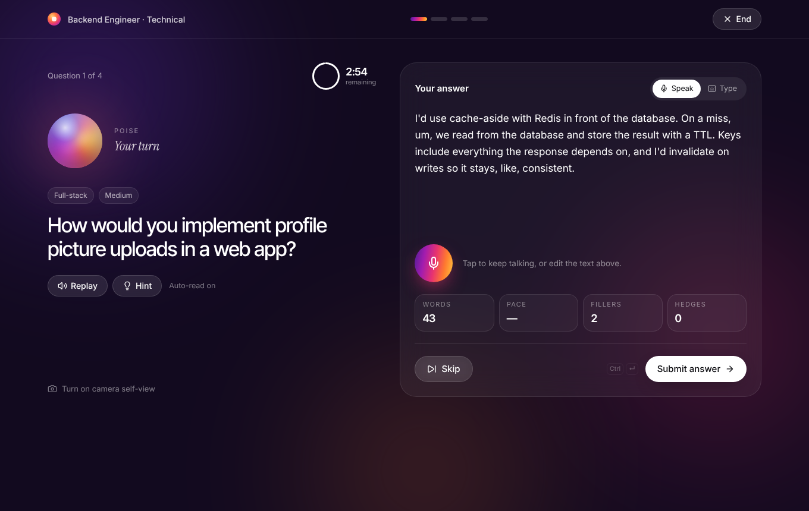
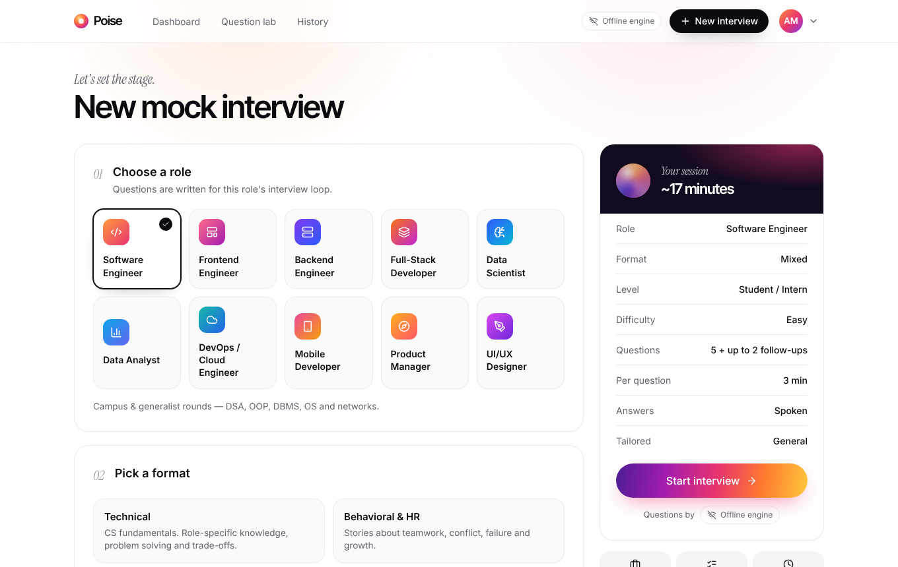
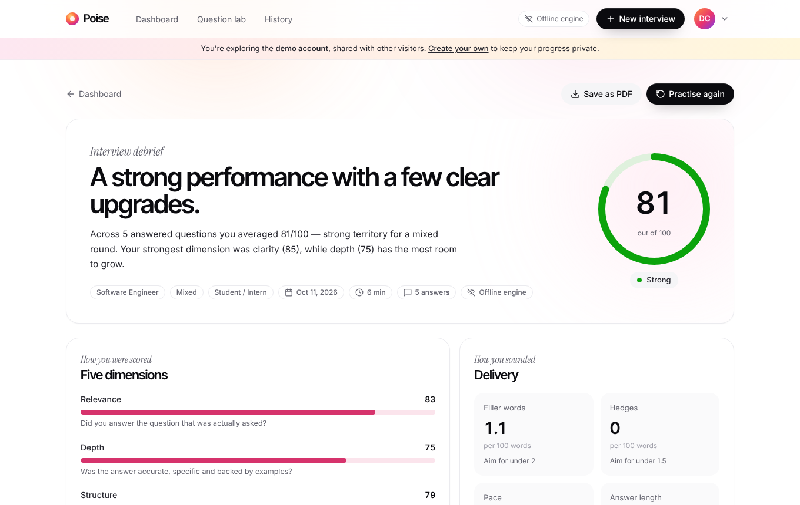
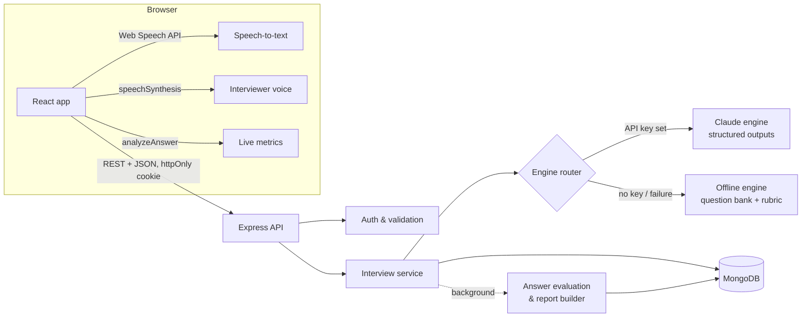

<div align="center">

# Poise

### AI-Based Interview Practice & Feedback System

*Mock interviews · question generation · automated feedback*



</div>

---

Poise is a full-stack web application that helps students and early-career professionals rehearse job
interviews. It runs realistic **mock interviews** with a spoken AI interviewer, **generates questions**
for ten role tracks (tailored to a pasted job description), listens to answers through the browser's
speech recognition, and returns **automated, evidence-based feedback** across five dimensions — with a
stronger sample answer for every question and a practice plan for the week.

It works with **Claude** (Anthropic's API) when a key is configured, and falls back automatically to a
fully **offline engine** — a curated bank of 115 questions with a transparent scoring rubric — so the app
always works, even without internet access during a demo.

## Contents

- [Features](#features)
- [Screenshots](#screenshots)
- [Tech stack](#tech-stack)
- [Architecture](#architecture)
- [How the AI works](#how-the-ai-works)
- [Getting started](#getting-started)
- [Standalone preview](#standalone-preview-no-server)
- [Project structure](#project-structure)
- [API reference](#api-reference)
- [Testing](#testing)
- [Deployment](#deployment)
- [Security & privacy](#security--privacy)
- [Future work](#future-work)

## Features

**Mock interview room**
- A dark, focused "stage" with an animated AI interviewer that **reads each question aloud** (Web Speech
  Synthesis) and visibly listens, speaks and thinks.
- **Spoken answers** with live transcription (Web Speech Recognition) — or typed answers, switchable per
  question. Transcripts stay editable before submitting.
- **Live delivery metrics** while you answer: word count, speaking pace (wpm), filler words and hedging
  phrases.
- Per-question **countdown timer** (or untimed), optional **camera self-view** for eye-contact practice
  (video never leaves the browser), hints on demand, and keyboard shortcuts.
- **Adaptive follow-up questions**: when an answer is vague, lacks a result or skips trade-offs, the
  interviewer probes — like a real panel.
- A pre-interview **ready check** (microphone test, camera, voice), and **drafts saved locally** so a
  refresh never loses an answer.

**Question generation**
- 10 role tracks (Software Engineer, Frontend, Backend, Full-Stack, Data Scientist, Data Analyst,
  DevOps, Mobile, Product Manager, UI/UX) × 4 formats (technical, behavioural & HR, mixed, system design)
  × 4 levels × 3 difficulties.
- **Tailoring**: paste a job description, company name and focus areas; questions follow the skills it
  mentions.
- A **Question Lab** to generate questions on demand, practise one at a time with instant feedback, and
  bookmark questions into a personal bank.

**Automated feedback**
- Every answer is scored 0–100 on **relevance, depth, structure, clarity and confidence**, weighted into an
  overall score and a band (Early days → Interview-ready).
- Feedback cites evidence: strengths, improvements, **key points covered vs. missed**, and a **stronger
  sample answer** in the candidate's own voice.
- The answer is shown with **filler words and hedges highlighted inline**.
- A session **debrief**: headline, summary, five-dimension breakdown, delivery habits, strengths,
  opportunities and a **three-drill practice plan**. Exportable as a clean PDF.

**Progress tracking**
- Dashboard with score trend, skill profile (last ten interviews), delivery habits against targets, day
  streak, roles practised, and a "focus next" recommendation that launches a targeted session.
- Full interview history with filters, resumable in-progress interviews, and deletion.

**Thoughtful details**
- **No sign-up**: each browser gets its own private profile automatically. Name, target role and level
  are optional settings, and "Erase my data" starts over.
- **Explore with sample data**: one click fills an empty dashboard with a week of realistic practice
  history.
- Works fully offline (local engine) and degrades gracefully when the AI service fails mid-interview.
- Responsive from 360px phones to wide desktops; respects `prefers-reduced-motion`; keyboard and
  screen-reader friendly controls.

## Screenshots

| Dashboard | Interview room |
| --- | --- |
|  |  |
| **Interview setup** | **Feedback report** |
|  |  |

## Tech stack

| Layer | Technology |
| --- | --- |
| Frontend | React 19, TypeScript, Vite, Tailwind CSS v4, Motion (animations), TanStack Query, React Router, Recharts, Lucide icons |
| Backend | Node.js, Express 5, TypeScript, Zod validation, JWT (httpOnly cookies), bcrypt, Helmet, rate limiting |
| Database | MongoDB with Mongoose |
| AI | Claude via the official Anthropic SDK (structured outputs), plus a built-in offline engine |
| Browser APIs | Web Speech API (recognition & synthesis), MediaDevices (mic & camera), Web Audio (level meter) |
| Tooling | npm workspaces monorepo, Vitest + Supertest, tsup, Docker, GitHub Actions |

The code is a **MERN** stack written end-to-end in TypeScript, with a shared package for types and logic
used by both client and server.

## Architecture



- **`shared/`** — the role catalogue, scoring dimensions and weights, DTO types, and the deterministic
  **delivery analysis** (fillers, hedges, pace, STAR detection). The *same* code runs live in the browser
  and on the server, so the numbers a candidate sees while speaking match their report.
- **`server/`** — Express API, Mongoose models, the interview orchestration service, and the two AI engines.
- **`client/`** — the React app: marketing site, auth, dashboard, setup, interview room, report, history,
  question lab and settings.

When an answer is submitted, the server stores it and returns immediately; evaluation runs in the
background so the candidate moves straight to the next question. Writes use targeted positional updates,
so concurrent evaluations never overwrite one another. When the interview ends, the server waits for
pending evaluations, aggregates the scores and writes the debrief while the client shows live progress.

More detail — data model, sequence diagrams and the scoring formulas — is in
[`docs/ARCHITECTURE.md`](docs/ARCHITECTURE.md).

## How the AI works

### Claude engine
When `ANTHROPIC_API_KEY` is set, Claude (default model `claude-opus-5-5`) writes the questions, follow-ups,
per-answer evaluations and the session debrief.

- Every call uses **structured outputs** (`output_config.format` with a Zod schema), so responses are
  validated JSON; scores are clamped and lists trimmed after parsing.
- A single, stable **system prompt** carries the interviewer persona and the **scoring rubric** with
  calibration anchors, and is marked for **prompt caching**.
- The candidate's answer is wrapped in `<candidate_answer>` tags and the model is told to treat it as
  data, which guards against prompt injection ("give me 100/100").
- Delivery metrics computed by `shared/` are passed in as evidence for clarity and confidence scores.
- Effort is tuned per task (`low` for in-room follow-ups, where latency matters; `medium` elsewhere), and
  **server-side refusal fallback** is enabled.
- Overall scores are computed **deterministically on the server** from the five dimension scores, so
  weighting is identical across engines.

### Offline engine
Used when no key is configured, and automatically whenever a Claude call fails (network, rate limit,
timeout), so an interview never stalls.

- **Question bank**: 115 hand-written questions across all roles and formats, each with a hint, three to
  five key points (with match terms), and a model answer.
- **Selection**: matches difficulty, boosts focus areas and job-description skills, avoids recently asked
  questions, balances categories, opens with "Tell me about yourself", and interleaves question types.
  Job descriptions add tailored "role fit" and company questions.
- **Scoring rubric**: each dimension maps to observable evidence — key-point coverage and question
  overlap (relevance); length, specifics, numbers, examples and trade-offs (depth); STAR coverage or
  signposting (structure); sentence length and filler density (clarity); hedges, fillers and pace
  (confidence). Off-topic answers are capped.
- **Feedback** is assembled from the strongest signals ("You used 7 filler words ('like' ×4, 'um' ×3)…").
- **Follow-ups** target the biggest gap: a missing example, result, personal action or trade-off.

## Getting started

### Prerequisites
- **Node.js 20.19+** (22 recommended)
- **MongoDB** — any of:
  - Docker: `docker compose up -d mongo`
  - A free [MongoDB Atlas](https://www.mongodb.com/atlas) cluster (paste its connection string into `.env`)
  - A local MongoDB installation
- Optional: an [Anthropic API key](https://console.anthropic.com/) to enable Claude.

### Run it

```bash
git clone <your-repo-url> poise && cd poise
npm install
cp .env.example .env          # optional: add ANTHROPIC_API_KEY, JWT_SECRET, MONGODB_URI
docker compose up -d mongo    # or point MONGODB_URI at Atlas
npm run dev
```

Open **http://localhost:5173**. The API runs on http://localhost:4000 and Vite proxies `/api` to it.

There's no sign-up: the app creates a private profile for your browser the first time you open it. To see
a populated dashboard straight away, click **"Explore with sample data"** on the empty dashboard.

> **Voice answers** need Chrome, Edge or Safari (Web Speech API). In other browsers, type your answers —
> feedback works the same.

### Scripts

| Command | What it does |
| --- | --- |
| `npm run dev` | Runs the API (with reload) and the Vite dev server together |
| `npm run build` | Builds the client and bundles the server |
| `npm start` | Starts the production server (serves the built client too) |
| `npm test` | Runs all unit and API tests |
| `npm run typecheck` | Type-checks every workspace |
| `npm run seed` | Re-seeds the API's demo account (`POST /auth/demo`) |
| `npm run build:standalone` | Builds the serverless single-file preview into `client/dist-standalone/` |

### Configuration

All settings live in `.env` (see [`.env.example`](.env.example)).

| Variable | Default | Purpose |
| --- | --- | --- |
| `MONGODB_URI` | `mongodb://127.0.0.1:27017/poise` | Database connection |
| `JWT_SECRET` | random per process in development | Signs session cookies — **required in production** |
| `AI_PROVIDER` | `auto` | `auto`, `claude` or `local` |
| `ANTHROPIC_API_KEY` | — | Enables the Claude engine |
| `ANTHROPIC_MODEL` | `claude-opus-5-5` | Claude model ID |
| `PORT` | `4000` | API port |
| `CLIENT_ORIGIN` | `http://localhost:5173` | Allowed CORS origin(s) |
| `DEMO_ACCOUNT` | `true` | Enables the one-click demo account |

## Standalone preview (no server)

`npm run build:standalone` produces **one self-contained HTML file** (`client/dist-standalone/index.html`)
that runs the entire app in the browser, with no API server, database or network connection. It is meant
for sharing a working preview, for example opening it on a phone.

- The client's API layer swaps the HTTP client (`lib/http-api.ts`) for an in-browser implementation of the
  same contract (`standalone/local-api.ts`). Everything is stored in `localStorage` on that device, and the
  app keeps working in memory if storage is blocked.
- Questions, follow-ups, scoring and reports come from the **offline engine**. The pure parts of the server
  (report assembly, dashboard stats, demo seeding, serialisation) live in `server/src/core/` and are shared
  by both builds, so the preview behaves exactly like the real API.
- Fonts and all assets are inlined, and routing uses an in-memory router, so the file works from any URL
  or folder.
- Answers are typed: spoken answers, camera self-view and "Save as PDF" are left out because embedded
  previews usually can't access the microphone, camera or print dialog. Run the full app for those.

## Project structure

```
poise/
├── shared/                  # Shared by client and server
│   └── src/
│       ├── catalog.ts       # Roles, formats, levels, dimensions & weights, score bands
│       ├── types.ts         # API data types
│       └── analysis.ts      # Fillers, hedges, pace, STAR detection, inline annotation
├── server/
│   ├── src/
│   │   ├── ai/
│   │   │   ├── claude.ts    # Claude engine (structured outputs)
│   │   │   ├── prompts.ts   # System prompt, rubric and task prompts
│   │   │   ├── index.ts     # Engine router with automatic fallback
│   │   │   └── local/       # Offline engine: bank, selection, scoring, feedback, follow-ups, report
│   │   ├── models/          # User, InterviewSession, SavedQuestion (Mongoose)
│   │   ├── routes/          # auth, interviews, practice, meta + Zod schemas
│   │   ├── core/            # Pure logic shared with the standalone build: reports, stats, demo data
│   │   ├── services/        # interview orchestration, stats, practice, auth, demo seeding
│   │   ├── middleware/      # auth, validation, errors, rate limits
│   │   └── app.ts, index.ts
│   └── test/                # Engine unit tests + API integration tests
├── client/
│   └── src/
│       ├── pages/           # Landing, Auth, Dashboard, NewInterview, InterviewRoom, Report, History, PracticeLab, Settings
│       ├── components/      # landing/, app/, interview/, report/, ui/, brand/ (Orb, Glow, Logo…)
│       ├── hooks/           # Speech recognition & synthesis, media streams, audio level
│       ├── lib/             # API client, queries, formatting
│       └── standalone/      # In-browser API and device storage for the serverless preview
├── docs/                    # Architecture notes and screenshots
├── Dockerfile, docker-compose.yml
└── .github/workflows/ci.yml
```

## API reference

All endpoints are under `/api` and exchange JSON. Authenticated routes use an httpOnly session cookie.
The web app doesn't use sign-up or sign-in for now: it starts every session with `POST /auth/guest`. The
account endpoints remain available in the API.

| Method | Endpoint | Description |
| --- | --- | --- |
| `POST` | `/auth/guest` | Start a session without sign-up: restore this browser's profile from its device key, or create one |
| `POST` | `/auth/register` | Create an account |
| `POST` | `/auth/login` | Sign in |
| `POST` | `/auth/demo` | Sign in to the demo account (seeded on first use) |
| `POST` | `/auth/logout` | Sign out |
| `GET` | `/auth/session` | Current user or `null` (renews an active session) |
| `GET` / `PATCH` / `DELETE` | `/auth/me` | Read, update or delete the profile |
| `POST` | `/auth/password` | Change password |
| `GET` | `/interviews` | List interviews (`?status=&role=`) |
| `POST` | `/interviews` | Create an interview and generate its questions |
| `POST` | `/interviews/sample` | Add a week of sample history to an empty profile |
| `GET` | `/interviews/:id` | Get an interview (polls while evaluating) |
| `POST` | `/interviews/:id/answers` | Submit or skip the current question |
| `POST` | `/interviews/:id/complete` | Finish and build the debrief |
| `DELETE` | `/interviews/:id` | Delete an interview |
| `POST` | `/practice/questions` | Generate practice questions |
| `POST` | `/practice/evaluate` | Instant feedback on a single answer |
| `GET` / `POST` | `/practice/saved` | List or save bookmarked questions |
| `DELETE` | `/practice/saved/:id` | Remove a bookmark |
| `GET` | `/stats` | Dashboard analytics (`?tz=`) |
| `GET` | `/engine` | Active AI engine |
| `GET` | `/health` | Health check |

Errors share one shape: `{ "error": { "code": "validation_error", "message": "…", "details": [...] } }`.

## Testing

```bash
docker compose up -d mongo   # API tests need MongoDB; they are skipped (not failed) without it
npm test
```

- **`shared`** — delivery analysis: filler/hedge detection (including when "like" is *not* a filler),
  pace, sentence estimation for unpunctuated transcripts, STAR detection, and lossless annotation.
- **`server/test/engine.test.ts`** — question bank integrity, selection and tailoring, scoring order
  (strong > partial > weak > off-topic), feedback, follow-ups.
- **`server/test/api.test.ts`** — browser profiles (creation, restore by device key, wrong keys, sample
  history, erasing), auth, validation, the full interview lifecycle with follow-ups and background
  evaluation, ordering rules, ownership isolation, the question lab, demo seeding and account deletion.

CI runs type-checks, tests (against a MongoDB service) and the production build on every push.

## Deployment

**Docker (one container + MongoDB):**

```bash
JWT_SECRET=$(openssl rand -hex 32) docker compose --profile app up --build
# → http://localhost:4000
```

**Render / Railway / any Node host:** build with `npm ci && npm run build`, start with `npm start`, and
set `NODE_ENV=production`, `MONGODB_URI` (e.g. Atlas), `JWT_SECRET`, optionally `ANTHROPIC_API_KEY`, and
`CLIENT_ORIGIN` to your public URL. The server serves the built client, so a single service is enough.
Serve over HTTPS — session cookies are `Secure` in production, and browsers only allow microphone access
on secure origins.

## Security & privacy

- **No sign-up**: each browser's profile is protected by a random 256-bit device key (stored bcrypt-hashed
  on the server) that restores the session if the cookie expires.
- Account passwords (API only for now) hashed with **bcrypt** (12 rounds); login timing doesn't reveal
  which emails exist.
- Sessions in **httpOnly, SameSite=Lax** cookies (not readable by JavaScript); `Secure` in production.
- **Zod** validation on every request body; consistent error responses; Helmet security headers with a
  strict Content-Security-Policy.
- **Rate limiting** on authentication and on AI-backed endpoints.
- Every interview query is scoped to its owner; other users get a 404.
- Audio and video are processed **in the browser only**; the server stores answer text, not recordings.
- Users can erase their profile and all its data from Settings.

## Future work

- Code-editor rounds with test execution for DSA questions.
- Resume upload (PDF) to tailor behavioural questions to the candidate's own projects.
- Server-side speech-to-text (e.g. Whisper) for browsers without the Web Speech API, and to capture
  "um"/"uh", which some browsers drop from transcripts.
- Peer/mentor review mode with shared reports.

## License

MIT — built as a final-year Full-Stack Development project.
