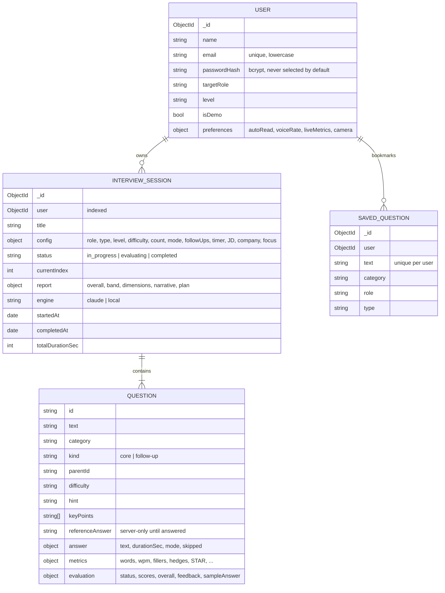
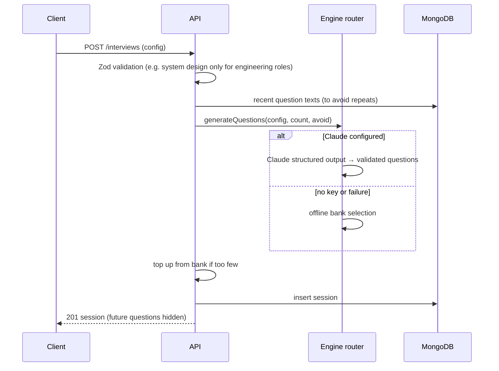
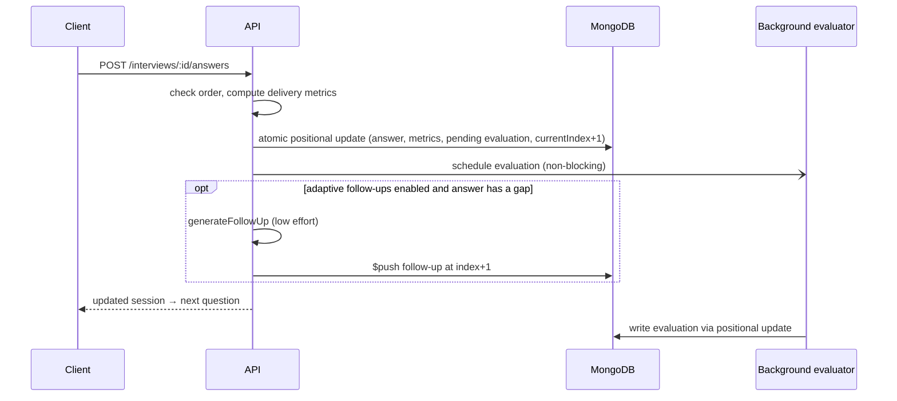

# Poise — architecture notes

This document goes one level deeper than the README: the data model, the main request flows, the
scoring model and the design system. It is written to be reusable in a project report.

## 1. System overview

Poise is a three-tier web application:

1. **Presentation** — a React single-page app (Vite, Tailwind CSS). It also does real-time work in the
   browser: speech-to-text, text-to-speech, microphone level metering, camera preview and live delivery
   metrics.
2. **Application** — an Express API in TypeScript. It authenticates users, validates input, orchestrates
   interviews, runs answer evaluation in the background and aggregates analytics.
3. **Data** — MongoDB via Mongoose.

A fourth component, the **AI engine**, sits behind an interface with two implementations (Claude and an
offline engine) and a router that falls back from one to the other.

A `shared` workspace package holds the catalogue (roles, formats, levels, dimensions, weights), the API
types and the delivery-analysis functions. Because both tiers import it, the browser's live metrics and
the server's stored metrics are computed by identical code.

## 2. Data model

Questions are **embedded** in their session: they are always read together, and a session is bounded
(at most 12 core questions plus follow-ups). Saved questions are a separate collection because they live
independently of any session.

**What the client can see.** While an interview is running, the API hides the text of questions the
candidate hasn't reached and the key points of questions they haven't answered, and never sends the
stored reference answer directly — just like a real interview.

## 3. Request flows

### 3.1 Creating an interview

### 3.2 Answering a question

The update is conditional on `status: "in_progress"` and `currentIndex` matching the question, so a
double-submit cannot record two answers. Evaluation and follow-up insertion touch different array
elements with targeted operators, so they never overwrite each other.

### 3.3 Finishing and the debrief

1. `POST /complete` moves the session to `evaluating` (rejected if nothing was answered).
2. Any answers still pending are (re)scheduled — this also recovers work after a server restart, which
   runs the same check at boot.
3. When the last evaluation lands, the report builder aggregates scores and habits, asks the engine for a
   narrative (headline, summary, strengths, improvements, three-drill plan) and marks the session
   `completed`.
4. The client polls every 1.5 s while the status is `evaluating`, showing per-answer progress.

## 4. Scoring model

### 4.1 Dimensions and weights

| Dimension | Question it answers | Weight |
| --- | --- | --- |
| Relevance | Did you answer the question that was asked? | 25% |
| Depth | Was it accurate, specific and backed by examples? | 25% |
| Structure | Could the interviewer follow it (STAR / signposting)? | 20% |
| Clarity | Was the language concise and easy to follow? | 15% |
| Confidence | Did you sound decisive, with few fillers and hedges? | 15% |

`overall = round(Σ score × weight)` — computed on the server for both engines.

Bands: **85+** Interview-ready · **70+** Strong · **55+** Promising · **40+** Needs practice · **<40** Early
days. Skipped questions score 0; questions never reached are excluded.

### 4.2 Delivery analysis (`shared/src/analysis.ts`)

- **Fillers**: um, uh, erm, basically, literally, actually, "you know", "I mean", "so yeah"… and *like*
  only in filler positions (after a comma or "and/so/was", not before "to/this/a").
- **Hedges**: "I think", "I guess", maybe, probably, "kind of", "sort of", "not sure"…
- **Pace**: words per minute for spoken answers of at least 10 seconds.
- **Sentences**: speech transcripts often lack punctuation, so when the text is clearly under-punctuated
  sentence count is estimated from typical spoken sentence length (16 words) instead of penalising clarity.
- **STAR**: phrase markers for situation, task, action (including "I + past-tense verb") and result.
- **Annotation**: splits text into filler/hedge/plain segments without altering it, for inline highlights.

### 4.3 Offline evaluator (`server/src/ai/local/scoring.ts`)

| Dimension | Evidence used |
| --- | --- |
| Relevance | `20 + 55·coverage + 25·min(1, overlap/0.45)`; capped for very short answers |
| Depth | 45% of a length curve (peaks at 110–260 words) + `40·coverage` + numbers (+8), examples (+8), trade-offs (+6) |
| Structure | Behavioural: `25 + 17·STAR parts (+7 for ≥4 sentences)`. Technical: `35 + 6·connectors (≤36) + sentences + direct opening` |
| Clarity | `92 −` long-sentence penalty `−` filler density penalty |
| Confidence | `86 −` hedge density `−` filler density `−` pace outside 100–175 wpm `+` assertive phrasing |

*coverage* is the share of key points whose match terms appear in the answer (short terms match whole
words only); *overlap* is the share of the question's content words echoed in the answer. Answers that
cover no key points and barely overlap the question are treated as off-topic and capped.

The unit tests pin the behaviour this has to guarantee: a model answer scores above 80, and scores fall
strictly from model → partial → weak, with off-topic answers below 35.

### 4.4 Claude evaluator

Claude receives the role, level, question, key points, reference answer (for calibration only),
delivery metrics and the candidate's answer in `<candidate_answer>` tags. The system prompt holds the
rubric with anchors (90+ / ~60 / below 30 per dimension) and level-adjusted calibration. Output is a
schema-validated object; the server clamps scores and computes the overall itself.

## 5. Reliability

- **Fallback**: every engine call goes through `runEngine`, which tries Claude and transparently uses the
  offline engine on any error (authentication, rate limit, timeout, refusal), logging why. The stored
  `engine` field records which one produced each result, and the UI shows it.
- **Background work** survives restarts (`resumeUnfinishedWork` at boot, plus a check on each poll).
- **Idempotent writes**: conditional updates prevent double-submission; saving a question is an upsert.

## 6. Security

- bcrypt (12 rounds) with a dummy-hash comparison for unknown emails to avoid user enumeration by timing.
- JWT in an httpOnly, SameSite=Lax cookie (Secure in production); 7-day expiry.
- Zod validation on every body; Helmet headers with a strict CSP; JSON body limit of 200 kB.
- Rate limits: 30 auth attempts / 15 min per IP; 60 AI-backed calls / 10 min per user.
- Ownership enforced in every query (`{ _id, user }`); other users' resources return 404.
- The shared demo account cannot change its password or be deleted.

## 7. Design system

The interface follows an editorial, warm aesthetic:

- **Type**: *Inter Tight* (display, tight tracking), *Inter* (body) and *Instrument Serif* italic for
  accents and eyebrows. Fonts are self-hosted via Fontsource, so the app works offline.
- **Colour**: near-black ink on white, with a signature aurora gradient (violet → magenta → rose →
  orange → amber). Data visualisation uses a single accent hue (`#d6336c`) on a lighter same-hue track;
  score bands use reserved status colours and are always labelled, never colour-only.
- **Components**: pill buttons (outline, solid, gradient, glass), 22–28 px radius cards, segmented
  controls, meters and score rings, and the animated **Orb** — the interviewer's visual identity, which
  idles, speaks (rings), listens (reacts to microphone level) and thinks (spins faster).
- **Motion**: Motion (Framer Motion) for reveals, page transitions and layout; every animation respects
  `prefers-reduced-motion`.
- **The interview room** uses a dark "stage" to reduce distraction; the rest of the app is light.

## 8. Standalone build

`npm run build:standalone` compiles the same client in Vite's `standalone` mode into a single HTML file
with every script, style and font inlined (`vite-plugin-singlefile`). It exists so the app can be opened
anywhere, for example on a phone, without a server.

- **One API contract, two implementations.** Pages only talk to `api` (`client/src/lib/api.ts`). In the
  normal build that is `httpApi` (fetch against `/api`); in standalone it is `localApi`
  (`client/src/standalone/local-api.ts`), which implements every method with the same shapes, rules and
  error messages as the Express services.
- **Shared core.** Logic that both need, such as report assembly, dashboard statistics, demo seeding, question
  conversion and serialisation, lives in `server/src/core/`. It has no database, config or Node imports,
  so the server services and the browser build call exactly the same code. The offline engine
  (`server/src/ai/local`) is reused the same way.
- **Storage.** One JSON document in `localStorage` (`poise:standalone:v1`), with an in-memory fallback
  when storage is unavailable. Passwords are stored as SHA-256 hashes; nothing leaves the device.
- **Routing.** A memory router replaces the browser router, so the file works from any URL or folder.
- **Capabilities.** Spoken answers, camera self-view and printing are switched off, because sandboxed
  previews generally can't use the microphone, camera or print dialog. Answers are typed, and
  questions can still be read aloud with speech synthesis.
